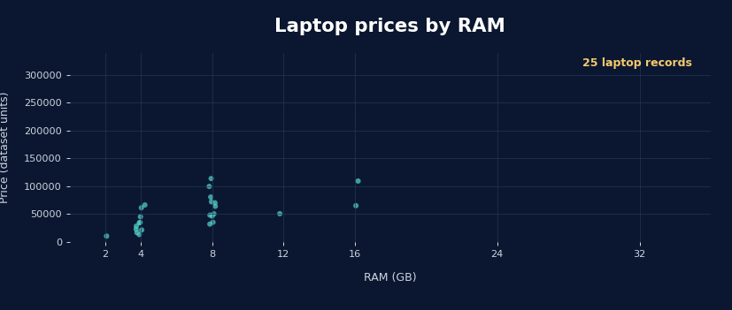

# 💻 Laptop Price Prediction

Predict laptop prices from hardware specifications using **machine learning regression**. This beginner-friendly Jupyter Notebook covers data exploration, feature engineering, regression model comparison, and hyperparameter tuning.

## Project Overview

The goal is to estimate a laptop's price from specifications such as its brand, RAM, processor, storage, display, graphics card, and weight.

The supplied dataset has **1,303 records**, reduced to **1,274** after removing duplicates. No missing values were found. The original `Price` column does **not** specify a currency, so all errors are reported in *dataset price units*.

## Workflow

- **Exploratory Data Analysis:** Examine prices, missing values, and brands.
- **Feature Engineering:** Extract RAM and weight values, TouchScreen and IPS indicators, SSD/HDD information, CPU family, GPU brand, and screen resolution.
- **Data Preparation:** Encode categorical variables and create an 80/20 training/test split.
- **Model Training:** Compare Linear Regression, Decision Tree, Random Forest, AdaBoost, and XGBoost.
- **Model Evaluation:** Use MAE, RMSE, and R², plus comparison plots.
- **Hyperparameter Tuning:** Tune Random Forest with `GridSearchCV` using training data only.

## Model Results

Results from the executed Notebook (80/20 split, `random_state=42`):

| Model | MAE ↓ | RMSE ↓ | R² ↑ |
|---|---:|---:|---:|
| Random Forest | **10,871.54** | 18,248.13 | 0.806 |
| XGBoost | 11,243.64 | **18,052.12** | **0.810** |
| Linear Regression | 12,835.51 | 20,014.79 | 0.766 |
| Decision Tree | 13,721.64 | 23,682.70 | 0.673 |
| AdaBoost | 18,412.58 | 23,546.97 | 0.676 |

**Key finding:** Random Forest performed best in MAE, while XGBoost achieved the best RMSE and R². GridSearchCV selected `max_depth=None`, `min_samples_leaf=1`, and `n_estimators=150` for Random Forest; in this run, tuning did **not** improve the baseline's test performance.

## Limitations and Dataset Source

- The dataset contains **historical laptop prices**, not current retail prices, and provides **no confirmed currency**.
- The random test split may not reflect performance on new brands, newer laptop generations, or different markets.
- Dataset provenance and redistribution permission were not specified in the supplied materials. **Check the original dataset license before publishing `laptop_data.csv` publicly.**

The data file (`laptop_data.csv`) and original class Notebook were supplied for this project.

